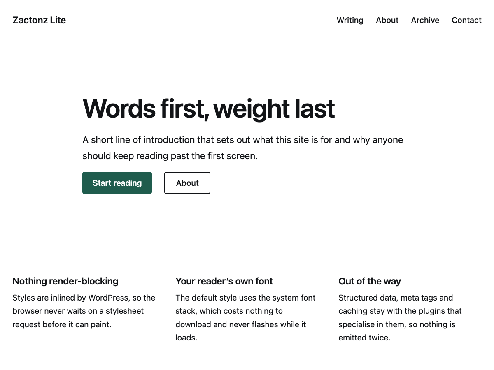

# Developer documentation

Zactonz Lite is a block theme. There is no PHP templating to override, no widget areas and no
settings screen — extension happens through `theme.json`, block templates, patterns and a small
number of filters.



| Guide | What it covers |
|---|---|
| [Extension points](extending.md) | Every filter the theme defines, the constants it sets, and how to turn a module off |
| [Navigation and menus](navigation.md) | The navigation block and the overlay menu |
| [Templates, parts and patterns](templates.md) | The eight templates, two parts, nine patterns and two block styles |
| [Sidebars and widget areas](sidebars.md) | Why there are none, and how to build the equivalent |
| [Sitemaps, SEO and metadata](sitemap.md) | What core already does, and what this theme deliberately leaves alone |
| [Styles and variations](styles.md) | The palette, typography, spacing scale, and how to add a variation |
| [Performance](performance.md) | Font preloading, and how to reproduce the numbers |

## The shape of the theme

```
functions.php          constants, then loads each module through a filter
inc/setup.php          text domain, editor style, pattern category, block styles, comment heading
inc/assets.php         main stylesheet, font preloading, navigation stylesheet substitution
theme.json             settings and styles
templates/  parts/  patterns/  styles/
assets/css/   assets/fonts/
```

Nothing else runs. There is no autoloader, no service container and no build step for PHP.

## A note on the rules this theme follows

It targets the WordPress.org theme directory, which forbids a theme from doing several things you
might otherwise expect: no caching, no SEO options, no settings screen, no admin widgets, and no
`remove_action( 'wp_head', … )` of any kind. Those are plugin territory, and Theme Check fails a
theme that ships them. Where a guide here says "the theme does not do X", that is usually why.

## Conventions

- Prefix for everything the theme owns: `zactonz_lite_` in PHP, `zactonz-lite` in slugs and CSS.
- Shipped PHP carries no comments and no docblocks. Reasoning lives in these documents and in the
  changelog, not in the source.
- Minified stylesheets ship beside their readable `.un-compressed.css` source, which the directory
  requires.
