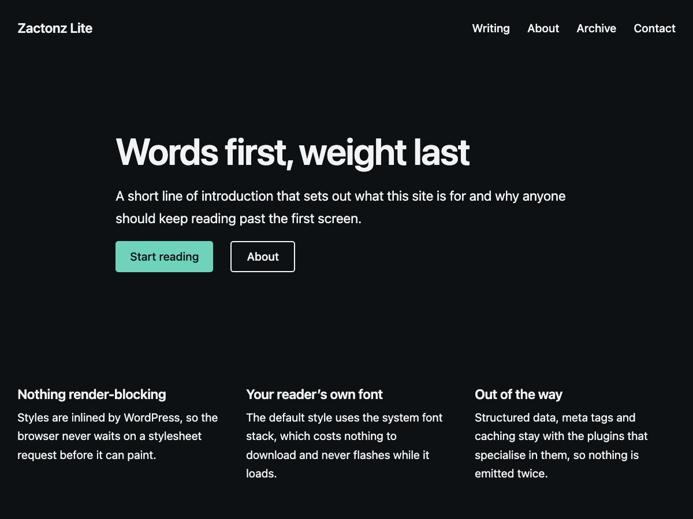
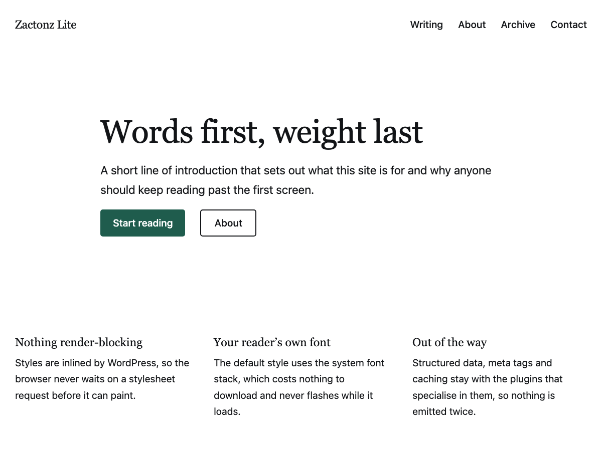
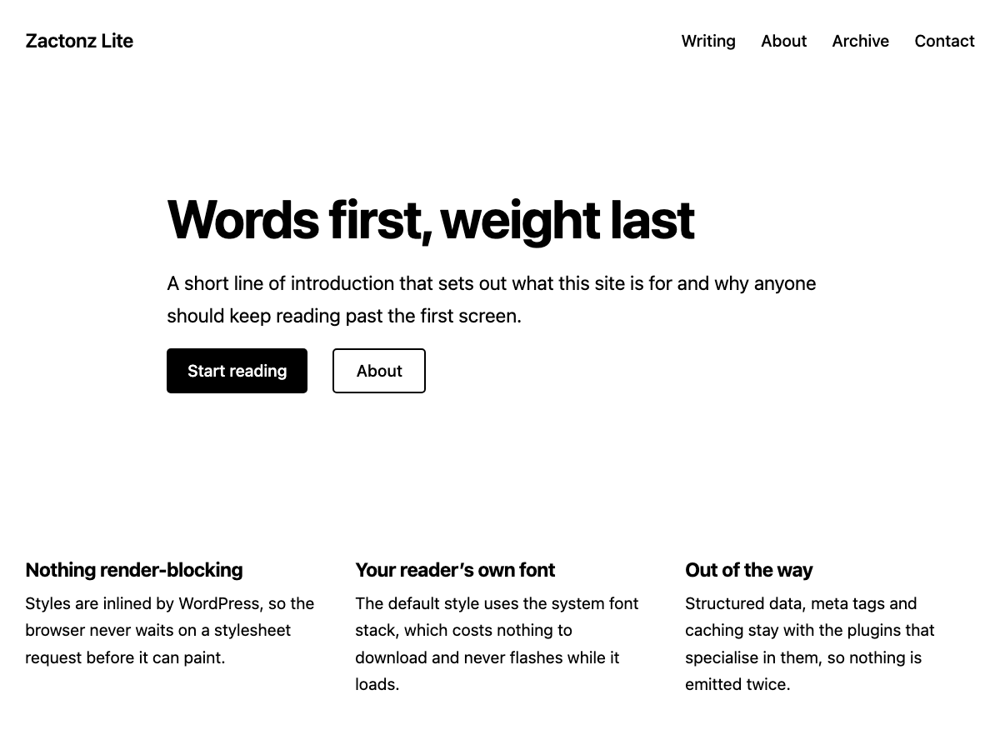

# Styles and variations



## theme.json

Version 3. Everything visual is declared there; `assets/css/main.css` carries only what
`theme.json` cannot express.

### Palette

Six colours, all referenced by slug so a variation can redefine them without touching markup.

| Slug | Role |
|---|---|
| `base` | Page background |
| `surface` | Raised background — cards, the Boxed group style |
| `contrast` | Body text |
| `contrast-muted` | Secondary text, meta |
| `accent` | Links, buttons, focus ring |
| `accent-soft` | Borders, the Framed image style |

Contrast was measured across all three variations: every pair is at least 6.26:1. If you add
colours, measure them — the `accessibility-ready` expectations apply to text and to the focus ring,
which needs 3:1 against its background.

### Typography

Three families: `sans`, `serif`, `mono`.

The serif is declared in `theme.json` but **only the Editorial variation uses it**. That is
deliberate and it is the whole font strategy: declaring `@font-face` costs only the CSS, because a
browser fetches the file only when text actually uses the family. So the default variation ships the
declaration, references nothing, and downloads nothing.

### Spacing

A seven-step scale, `20` through `80`, referenced as `var:preset|spacing|40` in markup and
`var(--wp--preset--spacing--40)` in CSS. Patterns and block styles use the scale rather than
hardcoded lengths, so changing one step reflows the theme consistently.

## Style variations

Three, as JSON files in `styles/`:

| File | What it changes |
|---|---|
| `styles/dark.json` | Inverts the palette |
| `styles/editorial.json` | Switches body text to the bundled serif |
| `styles/ink.json` | A higher-contrast monochrome palette |





A variation is a partial `theme.json`: include only the keys you change and core merges the rest.

### Adding one

Create `styles/your-variation.json`:

```json
{
	"$schema": "https://schemas.wp.org/trunk/theme.json",
	"version": 3,
	"title": "Your variation",
	"settings": {
		"color": {
			"palette": [
				{ "slug": "base",     "color": "#ffffff", "name": "Base" },
				{ "slug": "contrast", "color": "#111111", "name": "Contrast" }
			]
		}
	}
}
```

`title` is what appears in **Styles → Browse styles**. The file name becomes the slug.

If a bundled font should be preloaded when your variation is active, reference its slug somewhere in
the variation — the preload logic reads `wp_get_global_styles()` and matches
`font-family|<slug>`, so a family that is declared but unreferenced is correctly skipped.

### Testing one without writing to the database

Selecting a variation in the editor writes a `wp_global_styles` post, and that carries a trap worth
avoiding: a `wp_global_styles` post missing its `wp_theme` term cannot be found by the resolver,
which then creates a **new one on every write**. Seven duplicates accumulated during development
before this was noticed. If a variation seems not to apply, look for `wp-global-styles-<slug>-N`
posts.

To try one without any of that, filter it in for a single request from a throwaway mu-plugin:

```php
add_filter( 'wp_theme_json_data_user', function ( $data ) {
	if ( ! isset( $_GET['zl_style'] ) ) {
		return $data;
	}
	$file = get_template_directory() . '/styles/' . sanitize_file_name( $_GET['zl_style'] ) . '.json';
	return file_exists( $file )
		? $data->update_with( json_decode( file_get_contents( $file ), true ) )
		: $data;
} );
```

Delete it afterwards. This is how the captures on this page were taken.

## The stylesheets

| File | Purpose |
|---|---|
| `assets/css/main.css` | Minified; what ships |
| `assets/css/main.un-compressed.css` | The readable source you edit |
| `assets/css/navigation.un-compressed.css` | Its source |

Edit the `.un-compressed.css` file, then:

```bash
php tools/build-css.php
```

Both files must ship together — the directory requires a readable source beside any minified asset,
and `tools/lint.php` fails if they drift apart.

`main.css` is also registered as the editor stylesheet via `add_editor_style()`, so the editor and
the front end stay in step without a second file.
